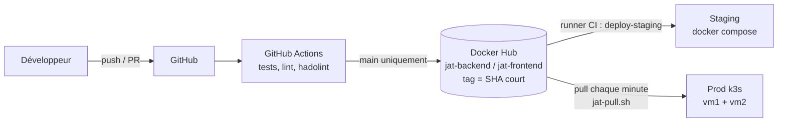

# Projet DevOps avancé — Déploiement continu d'une application multi-composants

Projet ESGI (DevOps avancé) : mise en production de l'application **Job Application Tracker**
(API Spring Boot + frontend React + PostgreSQL) avec conteneurs, Infrastructure as Code,
CI/CD, Kubernetes, déploiement sans interruption, auto-scaling et observabilité.

**Équipe :** Basma MORABIT · Mariam FATHALLAH · Siham AIDROUS

📄 **Dossier de projet** (architecture, choix techniques, difficultés, rôles) : [docs/dossier-projet.md](docs/dossier-projet.md)

## Vue d'ensemble



| Environnement | Où | Comment il est déployé |
|---|---|---|
| Staging | une machine avec Docker | **pipeline** : un runner GitHub auto-hébergé lance `deploy-staging` (pull de l'image publiée, health check, rollback automatique) ; ou à la main avec le script ; sur une VM Linux vierge, Docker et le staging s'installent avec `ansible/docker.yml` |
| Production | cluster k3s sur 2 VM (Multipass) | Ansible pour l'installation, puis **mode pull** : la VM récupère elle-même chaque nouvelle image |

## Structure du dépôt

```
app/backend          API Spring Boot (Dockerfile multi-stage, tests, tests d'intégration)
app/frontend         Frontend React / Vite servi par nginx (Dockerfile multi-stage)
.github/workflows    Pipeline CI/CD GitHub Actions (ci.yml)
staging/             docker-compose du staging + scripts de déploiement (.sh et .ps1)
ansible/             Installation du cluster k3s, déploiement de l'appli, mode pull, monitoring prod
k8s/                 Manifests Kubernetes (Kustomize) : postgres, backend, frontend, ingress, HPA
monitoring/          Prometheus, Grafana (dashboards golden signals + logs), Loki/Alloy, values Helm prod
docs/                Dossier de projet, procédures de maintenance, archive du projet Jenkins précédent
docker-compose.yml   Base PostgreSQL seule, pour développer l'appli en local
```

## 1. Pipeline CI/CD

Fichier : [.github/workflows/ci.yml](.github/workflows/ci.yml). Il se lance sur chaque pull request et sur chaque push sur `main`.

1. **Back-end** : `./mvnw verify` : tests unitaires sur H2, couverture JaCoCo minimale 50 %, et **analyse statique SpotBugs**
   (le build échoue si un bug est trouvé ; faux positifs Spring/JPA exclus et justifiés dans `app/backend/spotbugs-exclude.xml`).
   Les rapports (tests, couverture, SpotBugs) sont conservés 14 jours comme artefacts du run.
2. **Intégration** : l'API est lancée avec un vrai PostgreSQL et on teste register + login.
3. **Front-end** : `npm run lint` (ESLint), `npm run test:run` (Vitest), `npm run build`.
4. **Dockerfiles** : analyse hadolint.
5. **Images** (seulement sur `main`, si tout est vert) : build et push sur Docker Hub de
   `jat-backend` et `jat-frontend`, tagués avec le SHA court du commit (et `latest`).
6. **Déploiement en staging** (seulement sur `main`, après les images) : un runner GitHub auto-hébergé, installé sur la machine
   du staging, lance `deploy-staging.ps1` avec le tag publié (santé, smoke test, rollback). Résultat visible dans l'onglet
   Actions et dans *Deployments > staging*.

`main` est protégée : pull request obligatoire et 4 contrôles requis (Back-end, Intégration, Front-end, Dockerfiles).

Secrets GitHub nécessaires : `DOCKERHUB_USERNAME`, `DOCKERHUB_TOKEN`.

## 2. Staging (docker compose)

### Sur une VM Linux vierge, avec Ansible

Créer la VM (PowerShell) puis renseigner son IP dans `ansible/inventory.ini`, groupe `[staging]` :

```powershell
multipass launch 24.04 --name vm3 --cpus 2 --memory 4G --disk 15G --cloud-init C:\Users\Public\cloud-init.yml
multipass list
```

```bash
cd ansible
ansible-playbook docker.yml --ask-vault-pass
```

Le playbook installe Docker Engine et le plugin Compose, récupère le dépôt dans `/opt/jat-staging` et lance le
script de déploiement avec les secrets du vault. Les URL ci-dessous sont alors sur `http://<IP vm3>:<port>`.

### À la main, sur une machine qui a déjà Docker

Toutes les commandes se lancent depuis `staging/`.

```bash
cd staging
./deploy-staging.sh            # déploie la dernière version publiée par la CI
./deploy-staging.sh ccbdf81    # ou une version précise
```

Le script note la version en place, télécharge les images, redémarre back et front, attend
`/actuator/health = UP`, teste le front et `/api`, et **revient à la version précédente** en cas d'échec.
Sous Windows : `.\deploy-staging.ps1`.

| Service | URL |
|---|---|
| Application | http://localhost:8080 |
| API | http://localhost:8082 |
| Grafana (golden signals + logs) | http://localhost:3000 |
| Prometheus | http://localhost:9090 |
| cAdvisor | http://localhost:8081 |
| Loki | http://localhost:3100 |

Pour construire les images depuis le code local plutôt que Docker Hub : `docker compose up -d --build`
(sans les variables `DH`/`TAG`). Les détails sont en tête de `staging/docker-compose.yml`.

### Déploiement automatique depuis la CI (installation unique)

Sur la machine du staging (Docker démarré), installer un runner GitHub auto-hébergé avec le label `staging`
(*Settings > Actions > Runners > New self-hosted runner*, réservé aux admins du dépôt).

**Sur un PC Windows** (onglet *Windows*), puis :

```powershell
./config.cmd --url https://github.com/AnecV8/Projet-devops-avancee --token <TOKEN> --name staging-<machine> --labels staging
./run.cmd    # pas en service Windows : le runner doit accéder au Docker de l'utilisateur
```

**Sur la VM Linux du staging (vm3, installée par `ansible/docker.yml`)** : même page GitHub, onglet *Linux*, puis :

```bash
ssh ubuntu@<IP vm3>
mkdir actions-runner && cd actions-runner
# télécharger et extraire l'archive indiquée sur la page GitHub (curl -o ... puis tar xzf ...)
./config.sh --url https://github.com/AnecV8/Projet-devops-avancee --token <TOKEN> --name staging-vm3 --labels staging --unattended
sudo ./svc.sh install ubuntu     # service systemd, lancé en tant que ubuntu (membre du groupe docker)
sudo ./svc.sh start
```

Le job `deploy-staging` détecte le système du runner : `deploy-staging.ps1` sous Windows, `deploy-staging.sh` sous Linux
(avec les secrets de `/etc/jat-staging.env`, écrit par Ansible depuis le vault).

Ensuite, chaque fusion sur `main` déploie le staging. *Actions > CI/CD > Run workflow* relance toute la chaîne.

## 3. Production (k3s sur 2 VM, avec Ansible)

### Prérequis

- 2 VM Ubuntu joignables en SSH par clé (ici Multipass : `vm1` serveur, `vm2` agent).
- Sur le poste qui lance le déploiement : Ansible, et kubectl **de la même version mineure que k3s** (v1.33).
- Sous Windows avec WSL + Multipass : autoriser le routage entre les deux réseaux (PowerShell admin, à refaire après chaque redémarrage) :

```powershell
Get-NetIPInterface | Where-Object { $_.InterfaceAlias -like 'vEthernet (WSL*' -or $_.InterfaceAlias -like 'vEthernet (Multipass*' } | Set-NetIPInterface -Forwarding Enabled
```

### Configuration (une seule fois)

```bash
cd ansible
# 1. Mettre les IP des VM dans inventory.ini (multipass list)
# 2. Créer les secrets puis les chiffrer
cp group_vars/all/vault.yml.example group_vars/all/vault.yml
#    remplir db_password, jwt_secret et grafana_admin_password
ansible-vault encrypt group_vars/all/vault.yml
# 3. Vérifier l'accès aux VM
ansible all -m ping --ask-vault-pass
```

### Installer le cluster et déployer l'application

```bash
ansible-playbook site.yml --ask-vault-pass
export KUBECONFIG=$PWD/kubeconfig          # généré par le playbook, jamais commité
kubectl get nodes                          # vm1 et vm2 en Ready
kubectl -n jat get pods -o wide
```

`site.yml` prépare les VM, installe le serveur k3s sur vm1, joint vm2 comme agent, déploie l'appli
(`deploy.yml`) et active le mode pull (`pull.yml`). Il est **idempotent** : relancé sur un cluster à jour,
il affiche `changed=0`.

Application : `http://<IP de n'importe quelle VM>/` (Ingress Traefik fourni par k3s).

### Supervision de la production

```bash
ansible-playbook monitoring.yml --ask-vault-pass
```

Installe kube-prometheus-stack (Helm) dans le namespace `monitoring`, le ServiceMonitor du back-end
et le dashboard golden signals.

- Grafana : `http://<IP vm1>:30300` (utilisateur `admin`, mot de passe = `grafana_admin_password` du vault)
- Prometheus : `http://<IP vm1>:30090/targets`

### Mises à jour : le mode pull

Un cron sur vm1 lance `/usr/local/bin/jat-pull.sh` **chaque minute** : il compare le dernier tag publié
sur Docker Hub à l'image qui tourne, et lance un rolling update s'ils diffèrent. Il n'y a rien à faire après
un merge sur `main` : la nouvelle version arrive en prod en moins d'une minute après la publication de l'image.

```bash
ssh ubuntu@<IP vm1> tail -f /var/log/jat-pull.log        # suivre les déploiements
kubectl -n jat rollout history deployment/backend
```

Forcer une version précise : `ansible-playbook deploy.yml --ask-vault-pass -e app_version=<sha>`
(mettre d'abord le pull en pause, voir ci-dessous).

### Retour arrière

```bash
ssh ubuntu@<IP vm1> sudo touch /etc/jat-pull.pause      # sinon le pull remet la dernière version
kubectl -n jat rollout undo deployment/backend
# une fois la version corrigée publiée :
ssh ubuntu@<IP vm1> sudo rm /etc/jat-pull.pause
```

## Maintenance

Les opérations qui peuvent couper le service (VM de PostgreSQL, serveur k3s, mot de passe de la base…) et leurs
procédures sûres sont dans [docs/maintenance.md](docs/maintenance.md).

## Sécurité

- Aucun secret dans Git : GitHub Secrets pour la CI, **ansible-vault** (chiffré AES256) pour la prod.
- `ansible/kubeconfig` est dans `.gitignore` : il donne un accès administrateur au cluster.
- Images front servies par `nginx-unprivileged` (pas de root).

## Développer l'application en local

Voir [app/README.md](app/README.md). `docker compose up -d` à la racine démarre une base PostgreSQL de développement (port 5433).

## Point de départ

Le code reprend le projet CI/CD Jenkins précédent (tag `base-cicd-jenkins`, archive dans `docs/archive-cicd-jenkins`).
Jenkins, Nexus et le déploiement Docker/OpenTofu ont été remplacés par GitHub Actions et Kubernetes.