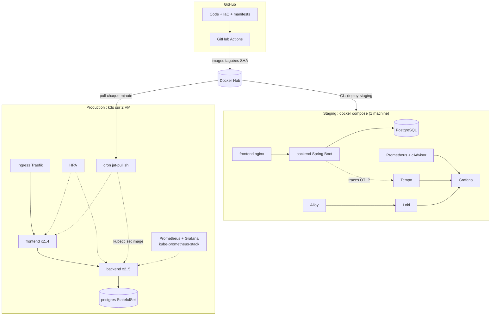
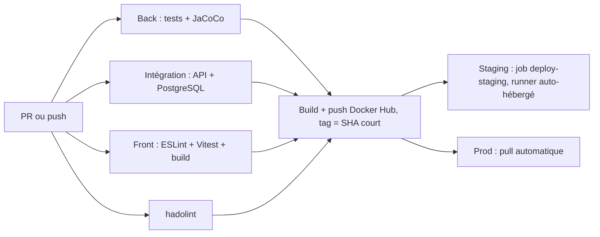

# Dossier de projet — DevOps avancé

**Application :** Job Application Tracker (Spring Boot + React + PostgreSQL)
**Équipe :** Basma MORABIT · Mariam FATHALLAH · Siham AIDROUS
**Dépôt :** https://github.com/AnecV8/Projet-devops-avancee

Les instructions pour déployer chaque environnement sont dans le [README](../README.md).

---

## 1. Architecture générale

## 2. Composants applicatifs

| Composant | Technologie | Rôle |
|---|---|---|
| Frontend | React + Vite, servi par nginx | Interface. nginx sert les fichiers statiques et transmet `/api` au back-end (même origine, pas de CORS). Sonde `/healthz`. |
| Backend | Spring Boot 4, Java 21 | API REST, authentification JWT, données isolées par utilisateur. Expose `/actuator/health` et `/actuator/prometheus` (Micrometer). Schéma géré par Liquibase. |
| Base de données | PostgreSQL 16 | Stockage des candidatures et des utilisateurs. |

## 3. Architecture Docker

- **Backend** : Dockerfile multi-stage. Une étape `eclipse-temurin:21-jdk` compile avec Maven, l'image finale
  `eclipse-temurin:21-jre` ne contient que le jar.
- **Frontend** : Dockerfile multi-stage. `node:22-alpine` construit l'appli, l'image finale
  `nginx-unprivileged:1.27-alpine` (sans root) sert le résultat. L'URL du back-end est injectée au démarrage
  (`BACKEND_URL`), donc **la même image** sert en staging et en prod.
- Les Dockerfiles sont analysés par **hadolint** dans la CI.
- **Docker sur la VM de staging** est installé par Ansible (`ansible/docker.yml`) depuis le dépôt officiel Docker
  (Docker Engine + plugin Compose), sur une VM séparée des nœuds k3s.
- `docker-compose.yml` à la racine : base PostgreSQL seule pour le développement local.

## 4. Environnements staging et production

| | Staging | Production |
|---|---|---|
| Plateforme | docker compose sur une machine dédiée ; sur une VM Linux vierge, Docker est installé par Ansible | Kubernetes **k3s v1.33** sur 2 VM Multipass (vm1 serveur, vm2 agent) |
| Images | les mêmes images Docker Hub que la prod | idem |
| Déploiement | automatique par la CI (runner auto-hébergé, `deploy-staging.ps1`) : health check + smoke test + rollback ; variante Linux reproductible : `ansible/docker.yml` | mode pull : cron chaque minute sur vm1 |
| Config | variables d'environnement du compose | ConfigMap + Secret Kubernetes |
| Supervision | Prometheus + cAdvisor + Grafana | kube-prometheus-stack (Prometheus Operator + Grafana) |
| Logs | Loki + Alloy | — (voir limites) |
| Traces | OpenTelemetry (agent Java) + Tempo | — (voir limites) |

### Architecture Kubernetes (namespace `jat`)

- **postgres** : StatefulSet avec volume persistant (StorageClass `local-path` de k3s).
- **backend** : Deployment, probes startup/readiness sur `/actuator/health` et liveness TCP, `preStop` + arrêt gracieux de Spring,
  PodDisruptionBudget (`minAvailable: 1`), requests/limits CPU et mémoire.
- **frontend** : Deployment, probes sur `/healthz`, `preStop`.
- **Ingress** Traefik (fourni par k3s) : l'appli répond sur `http://<IP d'une VM>/`.
- **HPA** sur backend et frontend.
- **ConfigMap** (config non sensible) et **Secret** (mot de passe base, secret JWT, créé par Ansible depuis le vault).
- Assemblage par **Kustomize** : la base `k8s/` ne fixe pas de version d'image, Ansible génère un overlay avec le tag.

## 5. Infrastructure as Code

- **Ansible** construit toute la prod à partir de 2 VM Ubuntu vierges (`ansible/site.yml`) :
  1. préparation des VM (paquets, swap désactivé) ;
  2. installation du serveur k3s sur vm1, récupération du kubeconfig ;
  3. jonction de vm2 comme agent ;
  4. déploiement de l'application (`deploy.yml`) ;
  5. installation du mode pull (`pull.yml`).
- `ansible/docker.yml` installe Docker sur une VM Ubuntu vierge et y déploie le staging (secrets lus dans le vault).
  La VM est séparée des nœuds k3s : Docker modifie les règles iptables et peut casser le réseau des pods.
- `ansible/monitoring.yml` installe la supervision de prod avec **Helm** (versions figées : chart 94.1.0, Helm 3.22.1).
- Les secrets sont chiffrés avec **ansible-vault**.
- Les playbooks sont **idempotents** : relancés sur un cluster à jour, ils affichent `changed=0`.
- Le staging est lui aussi décrit en code : `staging/docker-compose.yml` et le provisioning Grafana
  (datasources et dashboards en fichiers, aucune configuration à la main).

## 6. Pipeline CI/CD

- Outil : **GitHub Actions** (`.github/workflows/ci.yml`), à la place du Jenkins du projet précédent.
- Chaque pull request est testée avant la fusion. Les images ne sont publiées que depuis `main` et seulement si
  tous les contrôles sont verts.
- Tag d'image = SHA court du commit : chaque version en prod est reliée à un commit précis.
- **Analyse statique** : SpotBugs sur le back-end (dans le job Back-end), ESLint sur le front, hadolint sur les Dockerfiles ;
  les rapports de tests, de couverture et SpotBugs sont conservés comme artefacts du run.
- **Déploiement du staging par la CI** : après la publication des images, un runner auto-hébergé installé sur la machine
  du staging (GitHub ne peut pas la joindre) lance `deploy-staging` avec le tag publié ; le résultat est visible dans Actions.
- **Déploiement continu en mode pull** (demande du professeur) : ce n'est pas la CI qui pousse vers le cluster,
  c'est la VM qui va chercher. `jat-pull.sh` interroge l'API Docker Hub chaque minute, compare le dernier tag à
  l'image en cours et lance `kubectl set image` si besoin. Avantage : la CI n'a aucun accès au cluster
  (pas de kubeconfig ni de clé SSH dans GitHub). C'est le principe de GitOps (Argo CD, Flux), en version simple.

## 7. Déploiement sans interruption

### Choix de la stratégie

| Stratégie | Principe | Pour nous |
|---|---|---|
| **Rolling update** | les pods sont remplacés un par un | **retenue** : native dans Kubernetes, aucune ressource en plus, adaptée à 2 petites VM |
| Blue/Green | deux environnements complets, bascule d'un coup | double les ressources (2 bases ou base partagée), trop lourd pour 2 VM |
| Canary | une petite part du trafic va d'abord à la nouvelle version | demande un routage pondéré et une analyse des métriques (Flagger, Argo Rollouts) : piste d'amélioration |

**Conditions de réussite d'un déploiement** : chaque nouveau pod passe sa startup probe puis sa readiness probe
(`/actuator/health` UP, base comprise), et `kubectl rollout status` se termine avant le délai (300 s pour le back-end).
**Échec** : un pod n'est jamais prêt. Le rollout s'arrête, les anciens pods continuent de servir
(`maxUnavailable: 0`), et on revient en arrière avec `kubectl rollout undo`.

### Mise en œuvre

- **Rolling update** avec `maxUnavailable: 0` et `maxSurge: 1` : un nouveau pod démarre avant qu'un ancien s'arrête.
- **Readiness probe** : un pod ne reçoit du trafic qu'une fois prêt. Une image cassée ne remplace donc jamais
  les pods sains.
- **preStop + arrêt gracieux** : le pod finit ses requêtes en cours avant de s'arrêter.
- **PodDisruptionBudget** : au moins un pod back-end reste disponible.
- **Retour arrière** : `kubectl rollout undo` (5 révisions gardées), après avoir mis le pull en pause
  (`/etc/jat-pull.pause`).
- En staging, le script de Basma vérifie la santé après chaque déploiement et revient seul à la version précédente.

## 8. Auto-scaling

- **HorizontalPodAutoscaler** sur le CPU (cible 70 % des requests) : backend de 2 à 5 pods, frontend de 2 à 4.
- Les métriques viennent de metrics-server, inclus dans k3s.
- Le champ `replicas` a été retiré des Deployments : sinon chaque `apply` remettrait le nombre de pods à la valeur fixe
  et contredirait le HPA.
- Testé sous charge : passage de 2 à 3 pods backend, visible dans Grafana.

## 9. Supervision et observabilité

Tableau de bord **Golden signals** (le même en staging et en prod) :

| Signal | Mesure |
|---|---|
| Latence | temps de réponse de l'API (Micrometer) |
| Trafic | requêtes par seconde, par route |
| Erreurs | taux de 5xx (panne serveur, rouge au-dessus de 1 %) séparé des 4xx (erreur du client), réponses par code HTTP |
| Saturation | CPU, mémoire et réseau par conteneur/pod, % de la limite consommé (prod), CPU et heap de la JVM, nombre d'instances |
| Crashs | redémarrages de conteneurs sur 15 min |

- En haut du dashboard, 4 tuiles résument l'état : latence moyenne (rouge au-dessus de 0,5 s), trafic, part de 5xx,
  nombre d'instances back joignables (`up{job="backend"}`, qui passe de 2 à 3 quand le HPA ajoute un pod).
- Les requêtes excluent `/actuator` : les sondes de Kubernetes et de Prometheus ne sont pas des utilisateurs et
  fausseraient le trafic et la latence.
- Supervision **métier** (latence, erreurs, instances, via Micrometer) et **technique** (CPU, mémoire, réseau des
  conteneurs, via cAdvisor).
- **Tout en code** : la datasource et les dashboards sont chargés par le *provisioning* de Grafana (fichiers dans
  `monitoring/grafana/`), aucune configuration à la souris. Le même JSON sert en prod, car les panneaux visent la
  datasource par son uid (`prometheus`) et contiennent une requête par conteneur (staging) et par pod (prod).
- **Staging** : Prometheus collecte toutes les 15 s le back-end (`/actuator/prometheus`) et cAdvisor (métriques des
  conteneurs) ; historique conservé dans un volume.
- **Prod** : kube-prometheus-stack ; un **ServiceMonitor** fait collecter `/actuator/prometheus` sur chaque pod
  back-end, y compris ceux créés par le HPA. Les composants que k3s n'expose pas (controller-manager, scheduler,
  etcd, kube-proxy) sont désactivés pour éviter de fausses alertes.

## 10. Centralisation des logs et tracing

- En staging : **Alloy** lit les logs de tous les conteneurs via l'API Docker et les envoie à **Loki**.
  Il ajoute les labels `service` et `level` (niveau lu dans le format de chaque composant).
- Les stack traces Java sur plusieurs lignes sont regroupées en un seul log.
- Les logs de Loki et d'Alloy sont exclus pour éviter une boucle.
- Dashboard Grafana **Logs** : lignes par niveau, filtres par **service**, par **niveau** et par texte ; la recherche
  par **date** se fait avec la plage de temps de Grafana.
- Composants qui envoient leurs logs : front (nginx), back (Spring Boot), PostgreSQL, Prometheus, Grafana, cAdvisor.
- Choix de **Loki** plutôt qu'ELK : beaucoup plus léger (il indexe les labels, pas tout le texte), et il s'affiche
  dans le même Grafana que les métriques.

### Tracing distribué

Solution retenue : **OpenTelemetry** (standard ouvert) avec **Grafana Tempo** comme stockage, en staging.
- **Agent Java OpenTelemetry**, sans aucune modification du code ni de l'image : un conteneur d'initialisation
  (`otel-agent`, version figée 2.33.1) copie l'agent dans un volume partagé, et le back le charge au démarrage via
  `JAVA_TOOL_OPTIONS=-javaagent:...`. La configuration passe par des variables `OTEL_*` (12-factor).
- Chaque requête devient une trace : entrée HTTP (Tomcat), Spring Data, Hibernate, requêtes SQL (JDBC), avec la durée
  de chaque étape. L'identifiant de trace est propagé dans les appels sortants (en-tête W3C `traceparent`).
- Tempo reçoit les traces en OTLP (port 4318) et les garde 48 h.
- **Corrélation logs ↔ traces** : le `trace_id` est écrit dans chaque ligne de log du back
  (`LOGGING_PATTERN_CORRELATION`). Dans Grafana, un log Loki ouvre sa trace, et une trace ouvre ses logs
  (« Logs for this span »). Une trace n'a des logs que si l'application en a écrit pendant la requête (connexion,
  avertissement, erreur) : une simple lecture de la liste n'en produit pas.
- Pourquoi ce choix : OpenTelemetry est indépendant de l'outil de stockage (on pourrait passer à Jaeger ou Zipkin sans
  toucher au back), l'agent évite de modifier le code, et Tempo s'intègre au Grafana déjà en place : métriques, logs et
  traces au même endroit.
- Consultation : Grafana > Explore > Tempo > Search (service `jat-backend`).

## 11. Choix techniques et outils

| Besoin | Choix | Pourquoi |
|---|---|---|
| CI/CD | GitHub Actions | intégré au dépôt, gratuit, pas de serveur Jenkins à maintenir |
| Registry | Docker Hub | public, gratuit, API de tags utilisée par le mode pull |
| Orchestration | k3s | Kubernetes certifié en un binaire léger, avec Traefik, stockage local et metrics-server inclus : adapté à 2 petites VM |
| VM | Multipass (Hyper-V) | VM Ubuntu en une commande sous Windows |
| IaC | Ansible | demandé par le sujet, sans agent (SSH), idempotent |
| Manifests | Kustomize | inclus dans kubectl, permet de changer le tag d'image sans toucher la base |
| Supervision prod | kube-prometheus-stack (Helm) | Prometheus Operator + Grafana + exporters en une installation |
| Logs | Loki + Alloy | même Grafana que les métriques, léger, s'appuie sur des labels |
| Traces | OpenTelemetry (agent Java) + Tempo | standard ouvert, aucune modification du code, même Grafana |
| Secrets | GitHub Secrets, ansible-vault | jamais en clair dans Git |

## 12. Pratiques DevOps appliquées

- **Git** : une branche par fonctionnalité, pull request relue par un autre membre, Squash and merge, suppression de la branche.
- **Commits conventionnels** (`feat:`, `fix:`, `docs:`…).
- **Tout en code** : infrastructure, déploiement, dashboards, datasources.
- **Même image** du staging à la prod, configuration par variables d'environnement (12-factor).
- **Tests automatiques** à chaque PR, et seuil de couverture minimale.
- **Idempotence** des playbooks.
- **Déploiement continu** sans intervention humaine, avec retour arrière possible.
- **Observabilité** : métriques (4 golden signals), logs centralisés et traces distribuées dans un seul Grafana.

## 13. Difficultés rencontrées et solutions

| Difficulté | Solution |
|---|---|
| Le login renvoyait 500 au lieu de 401 sur un mauvais mot de passe | Mauvais identifiants interceptés par le gestionnaire global d'erreurs (401), test ajouté |
| nginx perdait le port dans l'en-tête Host, Spring refusait l'origine | `proxy_set_header Host $http_host` |
| `docker compose up --build` avec `DH`/`TAG` étiquetait du code local avec le nom de l'image officielle | Documenté : `--build` uniquement sans `DH`/`TAG` |
| cAdvisor ne voyait plus les conteneurs avec Docker 29 (images stockées par containerd) | Passage à cAdvisor v0.55.1 |
| Le dashboard Grafana ne se chargeait pas : le volume (`/var/lib/grafana/dashboards`) ne correspondait pas au chemin du provisioning | Volume monté sur `/etc/grafana/dashboards`, le chemin déclaré dans `dashboards.yml` |
| Ports du staging déjà occupés par les conteneurs de l'ancien projet Jenkins | Ports rendus configurables par variables (`BACKEND_PORT`, `GRAFANA_PORT`…) |
| Le bug CORS n'apparaissait qu'avec l'application complète | Découvert grâce au staging, corrigé avant la prod : c'est le rôle du staging |
| Tempo ne pouvait pas écrire dans son volume (l'image tourne avec un utilisateur non root) | `user: "0"` en staging ; amélioration possible : donner les droits au volume |
| Boucle de logs (chaque envoi de Loki/Alloy créait un log) | Exclusion des services loki et alloy dans Alloy |
| Stack traces Java découpées en dizaines de lignes | Étape `multiline` dans Alloy |
| WSL ne joignait pas les VM Multipass (deux réseaux Hyper-V séparés) | Activer le forwarding sur les deux interfaces (à refaire après redémarrage) |
| kubectl v1.37 trop récent pour k3s v1.33 | kubectl aligné sur la version du serveur |
| « node vm1 not found » juste après l'installation de k3s | Attente répétée (`until/retries`) dans Ansible |
| **Le kubeconfig a été poussé sur une branche** | Retiré et ajouté au `.gitignore`, cluster réinstallé pour invalider les certificats, Squash and merge pour qu'il n'arrive jamais sur `main` |
| Relancer Ansible affichait toujours `changed` | `kubectl diff` avant chaque apply, Helm relancé seulement si ses entrées changent : `changed=0` |
| Deux sources de vérité pour la version (Ansible et le pull), relevé en revue de code | Ansible garde la version en place par défaut, ne force que sur `-e app_version=` |
| Cibles Prometheus DOWN en prod | Composants non exposés par k3s désactivés dans le chart |
| SpotBugs signalait 16 alertes, toutes des faux positifs connus avec Spring/JPA/Lombok | Exclusions ciblées et justifiées une par une dans `spotbugs-exclude.xml` ; tout autre bug fait échouer le build |
| Échec ponctuel du job Back-end : Maven Central injoignable pendant le téléchargement du wrapper Maven | Relance du job ; amélioration possible : cache de `~/.m2/wrapper` |

## 14. Maintenance : opérations qui peuvent couper le service

Le détail et les procédures sont dans [maintenance.md](maintenance.md). Les principales :

| Opération | Risque | Parade |
|---|---|---|
| Drainer ou redémarrer la VM de PostgreSQL | **coupure totale** : 1 seule réplique, volume local attaché à la VM | fenêtre de maintenance, sauvegarde `pg_dump` avant |
| Redémarrer vm1 (serveur k3s) | plus de déploiement, d'auto-scaling ni de mode pull | hors heures d'usage ; à terme 3 serveurs |
| Changer `db_password` | **coupure totale** : PostgreSQL ne prend le mot de passe qu'à la création | `ALTER USER` d'abord, puis vault, puis `rollout restart` |
| Changer la version majeure de PostgreSQL | **coupure totale** : format de données incompatible | dump / restauration |
| Supprimer le namespace ou le PVC | **perte de données** | jamais sans sauvegarde |
| Migration de schéma destructive | erreurs pendant le rolling update | *expand / contract* |
| Redémarrer le PC hôte | **coupure totale** (VM arrêtées) | procédure de reprise documentée |

Avant toute opération : mettre le mode pull en pause (`/etc/jat-pull.pause`) et sauvegarder la base.

## 15. Limites et améliorations possibles

- **Alertes** : pas encore de notification automatique. Étape suivante : règles Prometheus (back injoignable,
  plus de 1 % de 5xx, latence au-dessus de 0,5 s) et Alertmanager vers Teams ou Slack.
- **Traces distribuées** : en staging uniquement, et elles commencent au back-end (nginx n'est pas instrumenté).
  En prod : même agent via un initContainer Kubernetes, et Tempo installé avec son chart Helm.
- **Logs en production** : Loki n'est déployé qu'en staging ; en prod il s'installerait avec le chart Helm
  `loki` et Alloy en DaemonSet.
- **Haute disponibilité** : un seul serveur k3s ; il en faudrait 3 pour survivre à la perte du control plane.
- **Base de données** : volume local sur une seule VM ; en vraie prod, base managée ou stockage répliqué.
- **Mode pull** : remplaçable par un outil GitOps (Argo CD, Flux) qui suivrait aussi les manifests, pas seulement les images.

## 16. Répartition des rôles

| Membre | Rôle | Réalisations principales |
|---|---|---|
| **Mariam FATHALLAH** | Développement, conteneurs, CI/CD, logs | Restructuration du dépôt, correctifs 401 (login) et CORS (nginx), Dockerfile front + nginx, pipeline GitHub Actions et publication des images, analyse statique SpotBugs et rapports, déploiement automatique du staging (runner auto-hébergé), centralisation des logs (Loki + Alloy) |
| **Basma MORABIT** | Staging et observabilité | Environnement staging docker compose, Prometheus + cAdvisor + Grafana provisionné, dashboard golden signals, script de déploiement staging semi-automatique avec health check et rollback (réutilisé par la CI et par Ansible), tracing distribué (OpenTelemetry + Tempo), revues de code (dont le kubeconfig poussé par erreur) |
| **Siham AIDROUS** | Production Kubernetes | Cluster k3s sur 2 VM avec Ansible, manifests Kubernetes, rolling update, HPA, déploiement continu en mode pull, supervision de la prod (kube-prometheus-stack), playbook d'installation de Docker pour le staging, documentation de maintenance |